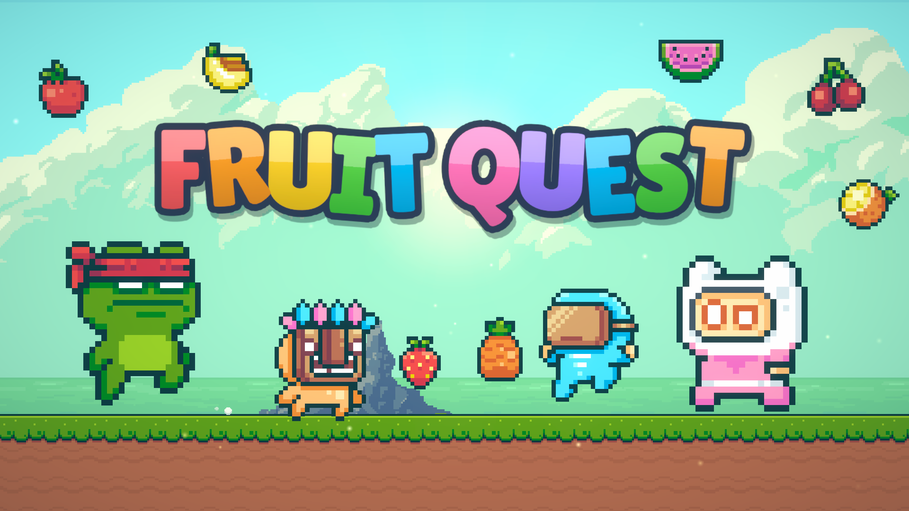
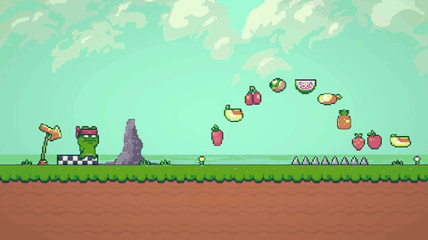
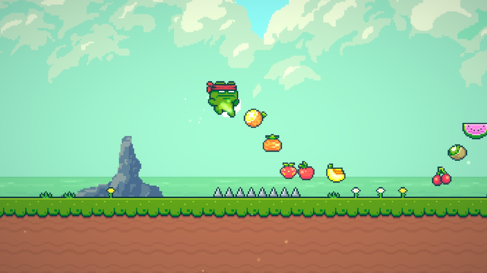
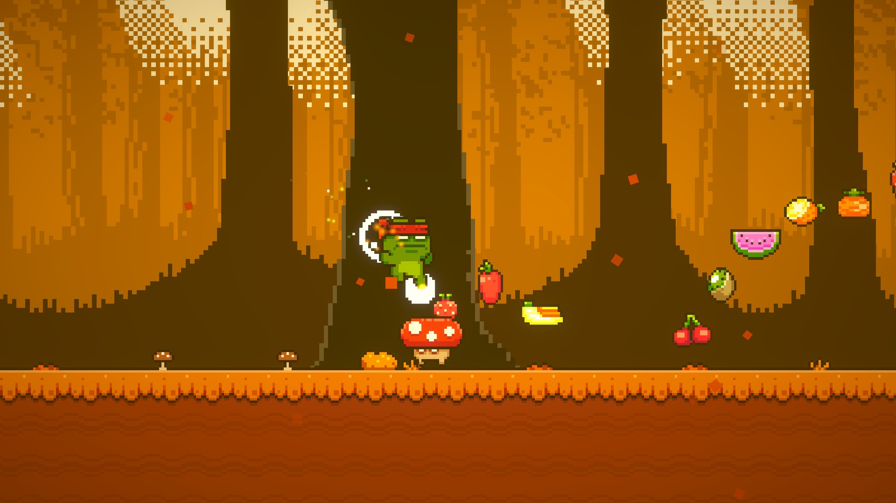
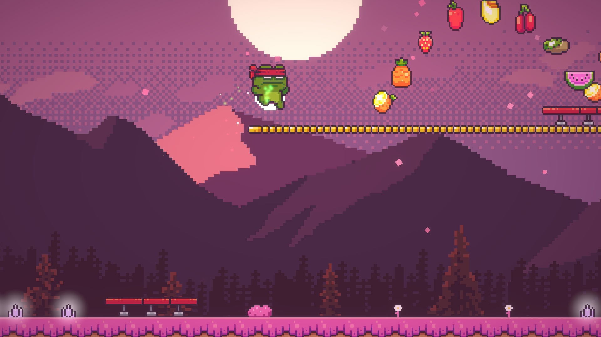
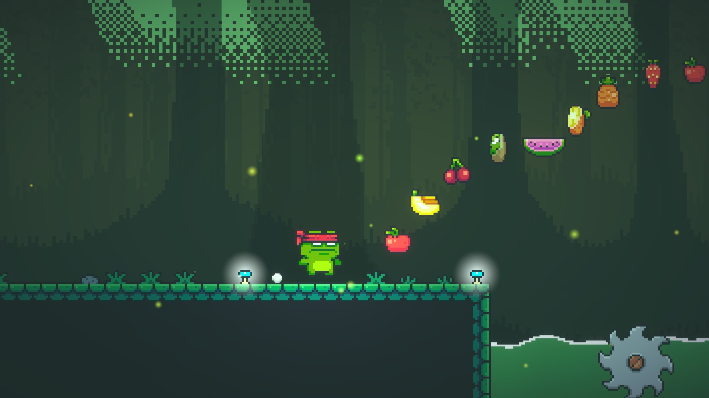
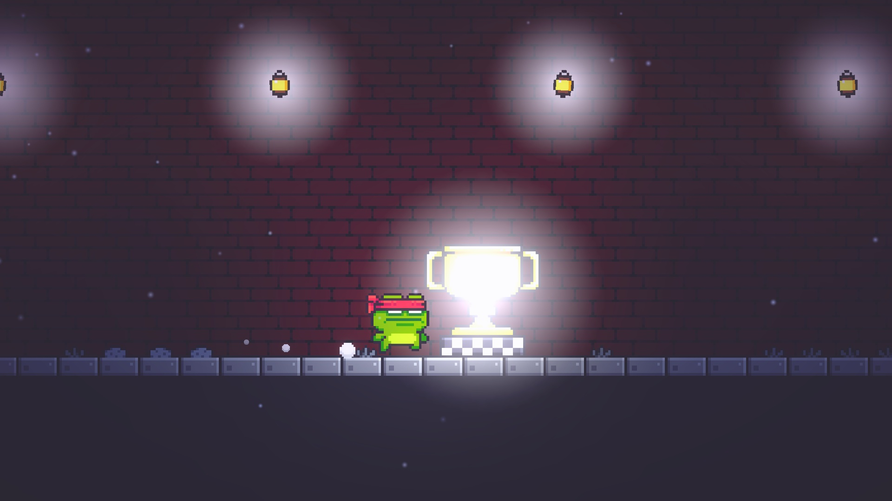

<p align="center">
  
</p>
<p align="center">
  
</p>
<p align="center">
  <a href="https://bluelolipop1.itch.io/fruit-quest"></a>
  &nbsp;
  <a href="https://github.com/vishwaMoger/FruitQuest/releases/tag/fruit-quest-v1"></a>
</p>
<p align="center"><sub>Free in your browser · no download · Android APK on the itch.io page</sub></p>
<p align="center">
  
  
  
  
  
  
</p>
<p align="center">
   PLAYER 1 READY / > 15 LEVELS. 5 WORLDS. 1 SKULL KING. / > GRAB EVERY FRUIT!" />
</p>

---

<h2 align="center">🎮 GAMEPLAY</h2>

<p align="center">
  
</p>
<p align="center"><b>Hop, dash and wall-jump through 15 pixel levels, grab every fruit and beat the Skull King!</b></p>

<p align="center">
  
</p>
<p align="center">
  
</p>

---

<h2 align="center">📸 THE WORLDS</h2>

<p align="center">
  
  
  <br/><sub>🏖️ Sunny Shores &nbsp;·&nbsp; 🍂 Autumn Woods</sub>
</p>
<p align="center">
  
  
  <br/><sub>🌄 Sunset Peaks &nbsp;·&nbsp; 🛕 Jungle Ruins</sub>
</p>
<p align="center">
  
</p>
<p align="center"><sub>🏰 Moonlit Castle: the Skull King's keep</sub></p>


1. **Sunny Shores**: grass cliffs by the sea (basics, moving platforms, trampolines, wall jumps)
2. **Autumn Woods**: golden forest (falling platforms, fire traps, fans, rinos, shooters)
3. **Sunset Peaks**: pink mountains (rock heads, bees, bluebirds, spike-head crushers)
4. **Jungle Ruins**: dark, lantern-lit temple (turtles, ghosts, bats, fat birds)
5. **Moonlit Castle**: the Skull King's keep (gauntlets and the boss)

---

<h2 align="center">🕹️ CONTROLS</h2>

| Action | Keyboard | Gamepad | Touch |
|---|---|---|---|
| Move | A/D or Arrow keys | Left stick | ◀ ▶ buttons |
| Jump / double jump | Space, W, Z or Up | A | ▲ button |
| Wall jump | Hold toward a wall, then jump | | |
| Dash (air) | Shift, X or K | X | Dash button |
| Drop through a platform | Down + Jump | | |
| Pause | Esc or P | Start | Pause button |

Stars per level: ⭐ **finish**, ⭐ **collect all fruit**, ⭐ **take no damage**. Stars unlock new heroes.

---

<h2 align="center">⚙️ UNDER THE HOOD</h2>

<p align="center">
  
</p>

---

<h2 align="center">🌱 ORIGIN STORY</h2>

<p align="center">Fruit Quest grew out of my early prototype <a href="https://github.com/vishwaMoger/VishwaMoger_MiniPlatformer"><b>Mini Platformer</b></a>,<br/>and later became the base for <a href="https://github.com/vishwaMoger/TileTrek"><b>Tile Trek</b></a>, a live sliding-room puzzle (<a href="https://bluelolipop1.itch.io/tile-trek">play it on itch.io</a>).</p>

---

<h2 align="center">🛠️ FOR DEVELOPERS</h2>


<details>
<summary><b>🛠️ For developers: build, project layout and tooling</b></summary>

### Play

Open the project in Unity 6000.3, open `Assets/_Game/Scenes/Game.unity` and press Play.
The whole game runs in this one scene: menus sit over a live backdrop, and levels are built
at runtime from small text files, so restarts are instant and the build stays small.

| Action | Keyboard | Gamepad | Touch |
|---|---|---|---|
| Move | A/D or Arrow keys | Left stick | ◀ ▶ buttons |
| Jump / double jump | Space, W, Z or Up | A | ▲ button |
| Wall jump | Hold toward a wall, then jump | | |
| Dash (air) | Shift, X or K | X | Dash button |
| Drop through a platform | Down + Jump | | |
| Pause | Esc or P | Start | Pause button |

Stars per level: **finish**, **collect all fruit**, and **take no damage**. Stars unlock new heroes.

### Project layout

```
Assets/_Game/
  Art/            Pixel Adventure 1+2, parallax backgrounds, Lilita One font
  Audio/          chiptune music, SFX, UI sounds, jingles
  Editor/         ProjectSetup.cs (Tools > Fruit Quest > Run Full Setup)
  Rendering/      URP 2D pipeline asset, renderer, materials
  Resources/      GameAssets.asset (asset registry) + Levels/level_XX.txt
  Scenes/         Game.unity (the only scene)
  Scripts/        Core, Player, Level, Entities, Enemies, UI
  Shaders/        SpriteLitFX (2D lights + hit flash), ParallaxLayer, Water, Additive, IrisWipe
Tools/levelgen/   Python level authoring kit + reachability checker
```

The UI art, icons, decorations and most sound effects are generated in code at startup,
so they add nothing to the download size.

### Editing levels

Levels are written in Python in `Tools/levelgen/levels_w*.py`, then exported to text:

```bash
python Tools/levelgen/build_levels.py
```

The build script auto-polishes item placement (removes fruit overlapping other objects, lifts
objects out of terrain) and checks that every level can be finished with the player's real
jump reach. After it runs, use **Tools > Fruit Quest > Rebuild Asset Registry** in Unity.
You can also edit the `.txt` files directly. The map legend is documented in
`Assets/_Game/Scripts/Level/LevelData.cs`.

If you add or replace art or audio, run **Tools > Fruit Quest > Run Full Setup** again.

### CrazyGames (web)

- SDK: CrazyGames Unity SDK 5.33.0 in `Assets/CrazySDK` (demo folder removed). Two small local patches in
  `Scripts/Editor/Builder` are marked "Fruit Quest change" (keep null-check exceptions; Unity 6.3 file-list fallback).
- All SDK use goes through `Assets/_Game/Scripts/Core/Platform.cs` (never throws; no-op on Android/other hosts):
  gameplay start/stop, happytime, level context, midgame/rewarded ads, cloud + local saves.
- **Ads are off for Basic Launch** (`Platform.AdsEnabled`). Set it to true for Full Launch: midgame ads on
  next/retry after results or game over, rewarded revive, rewarded early unlock of the next hero.
- Build: **Tools > Fruit Quest > CrazyGames > 3. Release Build (single pass)** -> `Builds/CrazyGamesRelease`
  (upload every file). Local test: `python Tools/serve_webgl.py` then open http://localhost:8080.
- Store kit (covers, trailers, texts): `Builds/CrazyGames_Submission`. Regenerate in play mode with the dev console:
  `cover 0`, `clip <name> <level> <sec> <w> <h> <halfWidth>`, `trailer <out.mp4> <w> <h> <cover.png> <clip:start:count>...`
- Android: switch the platform back to Android before `Tools/u.sh` APK builds.

### itch.io (web)

- Build: **Tools > Fruit Quest > itch.io Build** -> `Builds/Itch/WebGL`. Same game, but the CrazyGames SiteLock
  whitelists itch's domains and the files use gzip with decompression fallback (itch.io sends no
  Content-Encoding headers). The CrazyGames settings are restored afterwards.
- Upload with [butler](https://itch.io/docs/butler/): `butler push Builds/Itch/WebGL bluelolipop1/fruit-quest:html5`

</details>

### 🙏 Credits (all free for commercial use)

- Art: **Pixel Adventure 1 & 2** by Pixel Frog; parallax backgrounds by **ansimuz** (CC0)
- Music: **Juhani Junkala** "Chiptune Adventures" (CC0), **Zane Little** "Flowerbed Fields" (CC0)
- Sounds: **Kenney** Interface Sounds and Music Jingles (CC0), plus the original project's sound effects
- Font: **Lilita One** by Juan Montoreano (SIL Open Font License, see `Art/Fonts/LilitaOne-OFL.txt`)

---

<p align="center">
  <b>Made with ❤️ and 🍓 by <a href="https://github.com/vishwaMoger">Vishwa Moger</a></b><br/>
  <sub>Game Developer · 3+ years · Bangalore, India · <a href="https://bluelolipop1.itch.io">more games on itch.io</a> · <a href="https://vishwa-moger.vercel.app">portfolio</a></sub>
</p>


